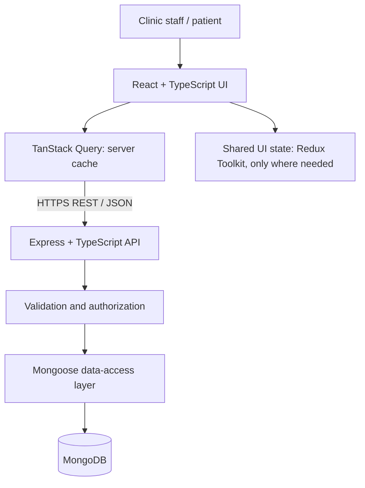

# VitalSync — Sprint 13 Planning Deliverables

> **Sprint scope: Planning only.** This repository documents requirements, UX, architecture, data model, state management, and proposed API contracts. It does **not** implement functional application code.

## Project overview

**Project name:** VitalSync  
**Track:** Fullstack  
**Category:** Healthcare appointment and patient management dashboard

VitalSync is a healthcare workflow dashboard intended to help clinic staff review daily activity, manage appointments, and access patient and appointment details through a clear, responsive interface. The current UI concept includes sign-in, dashboard, appointment list, appointment details, patient details, and a patient's own appointments.

### Problem statement

Small clinics need a clear way to view appointments and patient information without navigating disconnected screens. VitalSync proposes a single interface for daily appointment operations and basic patient-record access.

### Goals

- Make appointment status and daily workload easy to scan.
- Provide consistent appointment and patient detail views.
- Support desktop, tablet, and mobile layouts.
- Define a maintainable frontend state model and backend API contract before implementation.
- Document a MongoDB data model that supports the planned workflows.

### Non-goals for Sprint 13

- No production implementation of frontend or backend.
- No live patient data, real authentication, payment processing, or integrations with hospital systems.
- No claim of regulatory compliance. Any future handling of real health data will require a security, privacy, and legal review.

## Tech stack proposal

| Layer | Proposed technology | Purpose |
|---|---|---|
| UX/UI | Figma | Responsive design and handoff |
| Frontend | React + TypeScript + Vite | UI and routing |
| Styling | Tailwind CSS | Responsive design system |
| Client/server state | TanStack Query + a small Redux Toolkit store where shared UI state is needed | API cache and shared client state |
| Backend | Node.js + Express + TypeScript | REST API |
| Database | MongoDB + Mongoose | Persistent application records |
| Validation | Zod (or equivalent) | Request and form validation |
| Testing | Vitest, React Testing Library, Supertest | Planned unit/integration tests |
| Version control | Git + GitHub | Collaboration and review |

> This is a proposed stack, not an assertion that these tools are already configured in the repository.

## Prioritized feature scope

### P0 — required for the first usable version
1. Sign-in screen and protected application navigation (mock authentication during early development).
2. Dashboard summary cards and today's appointments list.
3. Appointment list with status, search, and basic filtering.
4. Appointment detail view.
5. Patient detail view.
6. Create and update appointment workflows.
7. Responsive desktop, tablet, and mobile layouts.
8. Loading, empty, error, and form-validation states.

### P1 — useful after P0
1. Patient directory and patient search.
2. Appointment pagination and date filters.
3. Patient's own upcoming appointment view.
4. Toast feedback and confirmation dialogs.
5. Role-aware navigation for clinic staff and patients.

### P2 — future enhancements
1. Calendar view and appointment reminders.
2. Audit history and operational analytics.
3. External calendar or messaging integrations, after privacy/security review.

## UX / Figma deliverables

The Figma design should include at least these three viewport classes:
- Desktop: approximately 1440 px wide.
- Tablet: approximately 768–820 px wide.
- Mobile: approximately 390 px wide.

The current design reference contains sign-in, dashboard, appointments, appointment details, patient details, and My Appointments screens. Verify that each important screen has an intentional responsive layout rather than merely shrinking the desktop canvas.

**Public Figma URL:** `[ADD PUBLIC FIGMA FILE LINK HERE]`

Screenshots to add after export/upload:
- `assets/figma-viewports/desktop.png`
- `assets/figma-viewports/tablet.png`
- `assets/figma-viewports/mobile.png`

See [`docs/FIGMA_HANDOFF.md`](docs/FIGMA_HANDOFF.md).

## Architecture

The planned system separates the React client, Express REST API, and MongoDB persistence layer.



The source diagram and notes are in [`docs/ARCHITECTURE.md`](docs/ARCHITECTURE.md).

## Frontend state tree

```text
App
├── auth
│   ├── currentUser
│   ├── role
│   └── authStatus
├── ui
│   ├── sidebarOpen
│   ├── theme
│   └── activeModal
├── appointments (server state: TanStack Query)
│   ├── list query: date, status, search, page
│   ├── appointment detail by ID
│   └── create/update mutations
└── patients (server state: TanStack Query)
    ├── patient list query
    └── patient detail by ID
```

**State rule:** API records and API loading/error states belong in TanStack Query. Keep only genuinely shared client/UI state in Redux Toolkit. Do not duplicate the same appointment or patient data in both stores.

## Proposed API contract

Base path: `/api/v1`

| Method | Endpoint | Purpose |
|---|---|---|
| POST | `/auth/login` | Sign in (planned) |
| POST | `/auth/logout` | End session (planned) |
| GET | `/auth/me` | Current user (planned) |
| GET | `/dashboard/summary` | Dashboard counts and summary |
| GET | `/appointments` | List appointments with filters/pagination |
| GET | `/appointments/:id` | Appointment details |
| POST | `/appointments` | Create an appointment |
| PATCH | `/appointments/:id` | Update appointment fields/status |
| GET | `/patients` | Search/list patients |
| GET | `/patients/:id` | Patient details |
| POST | `/patients` | Create a patient record (authorized staff only) |
| PATCH | `/patients/:id` | Update a patient record (authorized staff only) |

Detailed example request/response shapes, status codes, and validation expectations are in [`docs/API_CONTRACTS.md`](docs/API_CONTRACTS.md).

## MongoDB data model

The initial ERD uses **four collections**:
1. `users`
2. `patients`
3. `appointments`
4. `auditLogs`

The `patients` and `appointments` collections contain references to related records. See [`docs/ERD.md`](docs/ERD.md). These are planning-level schemas and must be reviewed before implementation.

## Quality and acceptance criteria

- Every P0 screen has desktop, tablet, and mobile behavior documented.
- All list/detail/create/update workflows have loading, empty, error, and validation states specified.
- API contracts identify expected inputs, outputs, and common error responses.
- Appointment references point to valid patient and user records.
- Server-side validation and authorization are required; frontend-only checks are insufficient.
- No real patient information is used in screenshots, demos, seed data, or the public repository.
- A future implementation must pass lint, type-check, tests, and production build before release.

## Sprint 13 submission checklist

- [ ] Public GitHub repository named `prodesk-capstone-VitalSync`
- [ ] This README includes the PRD, track, stack, and prioritized scope
- [ ] Public Figma URL added above
- [ ] Desktop, tablet, and mobile viewport screenshots added
- [ ] Architecture diagram reviewed and embedded
- [ ] Frontend state tree and API contracts reviewed
- [ ] MongoDB ERD (3–5 collections) reviewed
- [ ] `Prompts.md` contains the prompts used during planning
- [ ] QA demo video recorded (maximum 3 minutes)
- [ ] GitHub URL and demo video URL submitted through the required portal

**Submission links**
- GitHub repository: `[ADD REPOSITORY URL HERE]`
- QA demo video (≤ 3 minutes): `[ADD DEMO VIDEO URL HERE]`

**Deadline:** within 6 days of receiving the Sprint 13 brief. Confirm the exact due date from the official sprint portal/brief.
