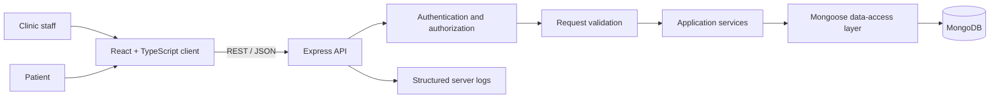

# VitalSync Architecture (Planning Only)

## System context

## Frontend responsibilities

- React components render screens and reusable UI elements.
- React Router (or an equivalent router) maps routes to screens.
- Tailwind CSS implements responsive layout and design tokens.
- TanStack Query owns remote API data, caching, loading/error state, and mutation invalidation.
- Redux Toolkit is limited to shared client-only state such as sidebar state, theme, and cross-page UI preferences.
- Form validation should be consistent with server validation.

## Backend responsibilities

- Express routes map HTTP requests to application services.
- Authentication middleware identifies the caller.
- Authorization checks role and record-level access.
- Request schemas validate path parameters, query parameters, and bodies.
- Service layer applies business rules, such as preventing invalid appointment transitions.
- Mongoose models persist data in MongoDB.
- Central error middleware returns a consistent error shape and appropriate HTTP status.

## Security and privacy considerations

- Use fictional data only during development and in public demos.
- Do not put secrets, credentials, tokens, or database connection strings in Git.
- Enforce authorization on the server; hiding a button in the frontend is not access control.
- Limit patient fields returned to each role and endpoint.
- Use HTTPS in deployed environments, secure session/token handling, rate limiting, and audit logging as appropriate.
- Complete a security/privacy review before handling real health information.

## Key design decisions

1. **REST API:** straightforward contract for a dashboard-oriented application.
2. **TanStack Query for server state:** prevents duplicating API records in a global Redux store.
3. **Redux Toolkit only for shared UI state:** keeps global state focused and easier to reason about.
4. **MongoDB references:** patients and appointments remain separate documents and can be queried independently.
5. **Audit log collection:** records selected important changes without embedding unbounded history into patient documents.

## Risks / open decisions

- Confirm role definitions and whether patient self-service is in the first release.
- Decide the authentication mechanism before implementation.
- Confirm timezone policy for appointment date/time.
- Define appointment status transition rules.
- Confirm the official brief's allowed stack and diagram format.
