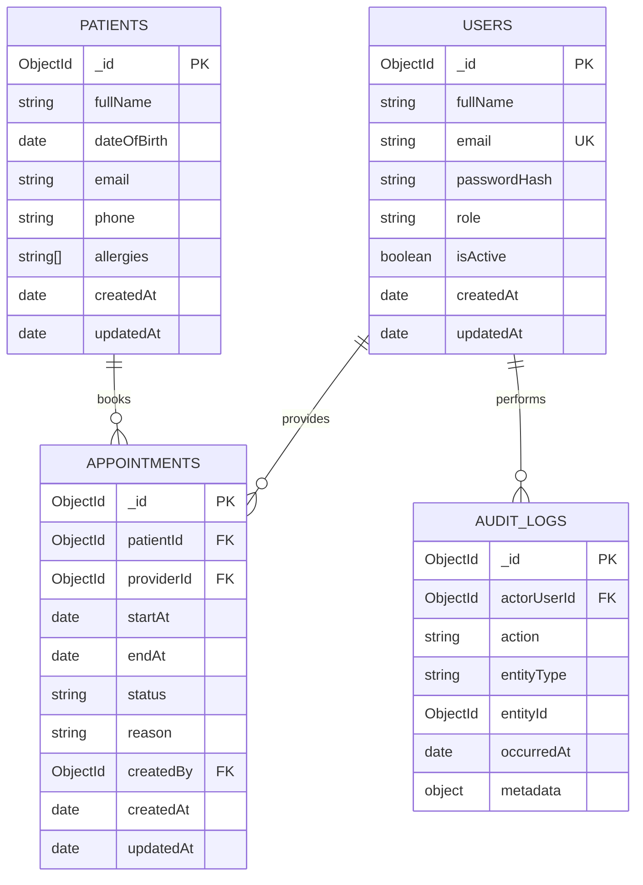

# MongoDB ERD — VitalSync

Planning model with four collections (within the expected 3–5 collection range). Use synthetic data only.

## Collection notes

### `users`
- Unique index on normalized `email`.
- `passwordHash` only; never store plaintext passwords.
- `role` should use a defined enum such as `admin`, `staff`, `provider`, `patient` only if these roles are actually needed.
- Do not expose password hashes in API responses.

### `patients`
- Store only fields justified by product requirements.
- Indexes should be selected from actual search patterns, for example normalized name or phone if staff are allowed to search those fields.
- Patient access must be enforced by server authorization, not by knowing an ObjectId.

### `appointments`
- Index candidates: `{ startAt: 1, status: 1 }`, `{ patientId: 1, startAt: -1 }`, and `{ providerId: 1, startAt: 1 }`.
- Validate `endAt > startAt`.
- Define conflict rules and status transitions before implementation.
- References do not automatically enforce referential integrity; validate referenced documents in the service layer.

### `auditLogs`
- Record important actions such as appointment creation/update and patient-record changes.
- Keep metadata minimal; do not copy entire patient records into logs.
- Consider retention and access rules before production.

## Relationship cardinality

- One patient can have many appointments.
- One provider user can have many appointments.
- One user can create many audit events.
- `auditLogs.entityId` is polymorphic and points to the affected record based on `entityType`; it is not a MongoDB-enforced foreign key.

## Privacy and security caveat

This is an educational planning model, not a clinical data standard. Before storing real health information, conduct a privacy/security review and determine applicable legal obligations.
